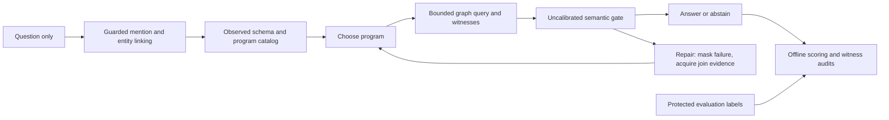

# Flagship controller

An auditable graph-reasoning research prototype with a synthetic component study and a question-only Freebase/WebQSP pipeline. **Working restricted prototype; not a final benchmark, validated novel method or submission-ready paper.** GitHub remains private.

## Current evidence

| Component | Evidence |
|---|---|
| Live prototype | Type/key-aware linking, explicit named-entity joins, schema-typed one/two-hop programs, bounded repair and complete traces. Latest five-question development check:3 exact answers, one partial answer, one abstention; macro F1 0.6727. |
| Prospective pilot | Ten further training-pilot questions; frozen fixed/repair policies, paired order, hashes and maximum budgets. Completed: fixed F1 .40 vs repair .30; a same-prefix diagnostic yields .40 vs .40 with +16.48% repair tokens. No benefit demonstrated. |
| Synthetic study | 50 base questions ×7 conditions ×16 variants, plus fault/budget diagnostics. No adaptive-acquisition advantage found in this fixture family. |
| Evaluation | Separate offline scorer, checks against Microsoft's official evaluator and source/configuration manifests. No official test-set controller run. |
| Research readiness | External baseline reproduction, calibrated reliability, independent semantic/STOP/recovery labels and final contribution assessment remain open. |

The five development questions were reused while fixing the software; their score is not held-out improvement. The Philippines answer remains too broad. A valid graph path and same-model semantic approval do not guarantee a correct answer.

## Current publication-development work

Question-span requirements, explicit type filtering, guarded case-insensitive canonical linking and contract-conditioned lexical retrieval are implemented in a separate development runner. Catalog diagnosis, an unexecuted 100-question reservation, review-pack generation and a baseline adapter specification are available. These do not establish final-paper results. [Measured development checkpoint](results/publication-development-report.md) and [protocol/limitations](evaluation/semantic-development-protocol.md). Latest two-case targeted check answers Mexico/GEICO exactly; Yale remains unresolved. This is not held-out improvement.

## Read the artifact

- [Current live report and reproduction commands](results/structured-pilot-report.md)
- [Completed paired comparison and negative findings](results/paired-pilot-report.md)
- [Publication readiness and ordered work packages](evaluation/publication-readiness.md)
- [Frozen comparison plan](results/paired-pilot-001/plan.json)
- [Live controller specification and limitations](evaluation/structured-controller.md)
- [Technical-report draft](paper/first-draft.md), [contribution decision](paper/contribution-decision.md) and [publication route](paper/venue-plan.md)
- [Synthetic results](results/synthetic-v2/report.md), [failure analysis](results/failure-analysis.md) and [protocol](evaluation/synthetic-protocol.md)
- [Acceptance record](evaluation/acceptance.md) and [application evidence map](paper/application-evidence-map.md)
- [Private server/model provenance](deployment/live-server.md)

Historical records remain available: [original live zero-coverage report](results/webqsp-live-report.md), [its failure/STOP audit](results/live-failure-analysis.md) and [synthetic bundle](artifacts/README.md). The original simple-chain runner and its provisional scorer are preserved to reproduce old artifacts.

## Verify locally

The runtime uses Python's standard library. Python 3.10+ suffices for the synthetic harness; measured live execution records its exact Python version. No model API key is needed for the existing local CPU model. Packaging/build dependencies are separate from direct source execution.

```sh
python3 scripts/restore_live_evidence.py
python3 -m unittest discover -s tests -q
python3 scripts/verify_live_artifacts.py
python3 scripts/verify_structured_artifacts.py
```

Reproduce the synthetic study:

```sh
python3 -m flagship_controller.pilot --count 50 --output runs/synthetic-reproduction
python3 scripts/check_reproduction.py runs/synthetic-reproduction
python3 -m flagship_controller.diagnostics
```

Synthetic inputs declare a start entity, relations and type obligations. They are not natural-language benchmark inputs. `engine.py` implements that experiment; `structured_runtime.py` implements the newer live catalog controller. Neither internal control is a faithful published-method reproduction.

Large raw traces are stored losslessly in a multipart compressed bundle to keep uploads manageable. The restoration command verifies part, archive and original-file hashes and refuses to overwrite changed files. Run it once after a clean checkout before tests or analysis. Source and small analysis files remain directly readable.

## Prepare WebQSP and score offline

Download the official [WebQSP archive](https://www.microsoft.com/en-us/download/details.aspx?id=52763), then:

```sh
python3 -m flagship_controller.benchmark /absolute/path/WebQSP.zip
python3 scripts/check_official_parity.py /absolute/path/WebQSP.zip
python3 -m flagship_controller.official_score PATH_TO_PREDICTIONS benchmark-data/webqsp/evaluation-only.jsonl
```

Intake separates raw question inputs from annotated entities, parses and answers. Pilot/calibration/policy groups come from official training data; official test stays separate. Protect the evaluation-only file from the runtime account. Never derive plans or retrieval envelopes from gold annotations. Full official data, database files and credentials are excluded from Git; selected questions and observed evidence appear in archived traces.

The official-semantics scorer implements Good/Complete question admission followed by best-F1 selection over all parses, including official empty-answer conventions. [Parity evidence](evaluation/official-scorer-cli-parity.json) records the exact comparison scope. The legacy `webqsp_score` command is for historical reproduction only.

## Run live and compare controls

The live runner requires the prepared private Freebase and Ollama services. See the [current report](results/structured-pilot-report.md) for exact replay commands. `fixed` makes one catalog choice; `repair` allows two, with failed programs masked and failure-triggered observations. Both share maximum budgets; realized costs can differ. Neither is the full proposed adaptive-acquisition method or a ToG reproduction.

`python3 -m flagship_controller.paired_study freeze --help` describes creating a new immutable pilot plan. `execute` checks source/model hashes and refuses overwrite; offline analysis uses `scripts/summarize_paired_study.py`. Do not retune during a frozen run or reuse development scores as independent confirmation.

## Runtime and evaluation boundary



The repair edge is bounded to one additional program choice. Offline labels and audit findings never feed an executing frozen policy. Triple existence and recorded-row consistency are distinct from semantic answer correctness.

## Project records

[Notion research hub](https://app.notion.com/p/3f0cb3d4ccd6807abdf1fb5a7ae54b76) · [experimental design](https://app.notion.com/p/3f5cb3d4ccd68186b41ef5ae2775d54a) · [primary protocol](https://app.notion.com/p/3f5cb3d4ccd68117a4b4ccf55cb48bb4) · [Todoist flagship task](https://app.todoist.com/app/task/6hQFhc6wCQ4WGP2J).

No external paper implementation is vendored. [ToG's pinned source audit](evaluation/tog-source-audit.json) identifies the adaptations needed before a meaningful reproduction. Public release, licensing, authorship and submission remain owner decisions after the concrete artifact is reviewed. No submission or publication status is claimed.
