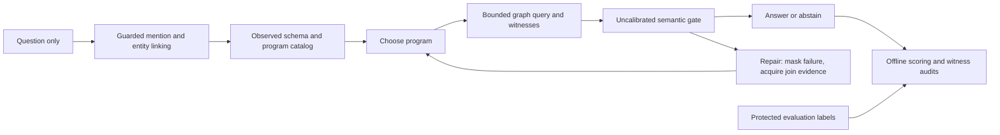

# Flagship controller

An auditable graph-reasoning research prototype with a synthetic component study and a question-only Freebase/WebQSP pipeline. **Working restricted prototype; not a final benchmark, validated novel method or submission-ready paper.** The repository is public; the owner approved publishing the verified17 October checkpoint. This is an exploratory artifact, not a submitted paper.

## Current work —18 October2026

The [prospective reserved-training benchmark](evaluation/benchmark-training-protocol.md) is running on the existing server after a separately retained known-case startup check. The fixed plan is100 questions ×3 seeds ×6 conditions (1800 outcomes), including the local ToG adaptation. All input bytes,15 inference modules, five offline-analysis sources, scheduling and the primary paired question-level analysis were frozen before the first reserved request. No final benchmark score exists while collection is incomplete; official test remains untouched. Failures remain in the denominator and the frozen method will not be tuned during collection.

**230 tests pass from a clean source snapshot;526 historical raw files restore and both prior finite/catalog reports reproduce exactly.** The isolated runtime materializes all15 frozen inference modules without scorer or annotations. The [author-review guide](evaluation/author-review-guide.md) explains the separate browser worksheet. Author review is welcome and remains distinct from independent semantic evaluation; neither has yet been received. Two independent reviewers are part of the semantic study design, not a universal journal approval requirement. Objective collection proceeds while review is pending. No new purchase or manuscript submission.

Earlier checkpoints below retain their original development scope and counts. Statements that the reserved100 was unrun describe those earlier dates.

## Completion-gated publication outputs

The [publication pipeline](evaluation/benchmark-publication-workflow.md) validates all 1,800 outcomes before reading evaluation labels or generating paper tables. It uses the original frozen analysis, retains exclusions and failures, and prepares the preselected 120-case semantic handoff plus a separate 20-case native-answer projection handoff. Packs remain blank; generated tables do not imply independent review or submission readiness. New packaging code was finalized during collection, without changing inference, primary analysis or case selection.

A [supplementary GPT review](paper/gpt-review-boundary.md) now records 120 explicit judgments on the earlier 30 development outcomes. It is unmasked automated error analysis, separate from human review and official benchmark scoring. The manuscript is v2.1. The [submission package map](paper/submission-package.md) identifies prepared files and the remaining evidence and author decisions.

## Current evidence

| Component | Evidence |
|---|---|
| Live prototype | Type/key-aware linking, explicit named-entity joins, schema-typed one/two-hop programs, bounded repair and complete traces. Earlier five-question development cohort:3 exact answers, one partial answer, one abstention; macro F1 0.6727. Later three-case regression checks are reported separately below. |
| Prospective pilot | Ten further training-pilot questions; frozen fixed/repair policies, paired order, hashes and maximum budgets. Completed: fixed F1 .40 vs repair .30; a same-prefix diagnostic yields .40 vs .40 with +16.48% repair tokens. No benefit demonstrated. |
| Synthetic study | 50 base questions ×7 conditions ×16 variants, plus fault/budget diagnostics. No adaptive-acquisition advantage found in this fixture family. |
| Evaluation | Separate offline scorer, checks against Microsoft's official evaluator and source/configuration manifests. No official test-set controller run. |
| Research readiness | External baseline reproduction, calibrated reliability, independent semantic/STOP/recovery labels and final contribution assessment remain open. |

The five development questions were reused while fixing the software; their score is not held-out improvement. The Philippines answer remains too broad. A valid graph path and same-model semantic approval do not guarantee a correct answer.

## Current publication-development work

Latest measured checkpoint: [nested catalog-by-guard development comparison](results/factorial-development-report.md). All30 frozen outcomes complete;212 tests pass. The controls separate the inspected parent-direction repair from the Chicago catalog change. Combined repair matches3/3 inspected official sets, but no held-out gain or independent semantic review is established. Reserved100 and official test remain unrun.

Latest offline checkpoint: [closed-guard limits and catalog availability](results/closed-guard-audit-report.md). A separate finite relational interpreter and captured-state catalog audit characterize false rejection, incomplete scopes and the catalog/guard confound.211 tests pass. These synthetic software checks add no live benchmark evidence or independent review. The separate [factorial harness](evaluation/factorial-development.md) is implemented, with a30-condition development freeze; wider evaluation remains gated.

Latest: [closed obligation checks, observed conjunctions and constraint-propagating repair](results/obligation-development-report.md). Two frozen versions retain36 further outcomes on six reused/development strings. The latest repair matches three inspected official sets, while fixed and guard-off match two.189 tests pass locally. This is narrow hand-designed rule development, not held-out gain, general semantic reliability, certified recovery or established novelty; reserved100 and official test remain unrun.

Current harder-case evidence (173 tests;30 new outcomes retained): [scope/direction failures and generic audit follow-up](results/harder-development-report.md). The frozen four-question comparison exposes false acceptance that prevents repair, plus a missing primary-anchor conjunction. Implementation integrity is separate from semantic reliability; reserved100 and official test remain unrun.

Previous checkpoint: [shared-state controls, constrained answers and retained failures](results/common-state-development-report.md). The framework is implemented and the30-outcome mechanics check is complete: five policies, two seeds, three reused question strings. Only one is an official original; no repair occurs and the baseline still adds a historical coin. This is not a benchmark gain. 161 tests pass; the 100-question reservation remains untouched.

Earlier checkpoint: [indexed baseline, retained semantic failures and reviewer handoffs](results/indexed-baseline-development-report.md). All30 baseline-development executions reuse five question strings;137 unit tests pass. Indexed decoding resolves formatting failure modes but still selects contextual names as answers. Thirty structured forms plus15 native-output forms remain unannotated, with zero reviewers completed. The [next-study design](evaluation/next-study-design.md) is preparation, not an executable freeze; the reserved100 and official test remain unrun.

Question-span requirements, type filtering, contract-conditioned retrieval and canonical-key/alias linking are implemented. The latest shared-linker development check answers Mexico, GEICO and Yale exactly; the new inverse/no-match controls are unscored behavior checks. Executable local ToG adaptations, independent-review validation and isolated source restoration are available. [Baseline/linking checkpoint and failures](results/baseline-development-report.md), [adaptation departures](evaluation/tog-adaptation.md) and [targeted CoG/CoR comparison](paper/closest-method-comparison.md). These are small, purpose-selected development checks, not held-out gains or reproduction of paper scores. The 100-question reservation remains unrun; 30 review forms remain unannotated.

## Read the artifact

- [Original structured live report and reproduction commands](results/structured-pilot-report.md)
- [Completed paired comparison and negative findings](results/paired-pilot-report.md)
- [Publication readiness and ordered work packages](evaluation/publication-readiness.md)
- [Frozen comparison plan](results/paired-pilot-001/plan.json)
- [Live controller specification and limitations](evaluation/structured-controller.md)
- [Technical-report draft](paper/first-draft.md), [contribution decision](paper/contribution-decision.md) and [publication route](paper/venue-plan.md)
- [Synthetic results](results/synthetic-v2/report.md), [failure analysis](results/failure-analysis.md) and [protocol](evaluation/synthetic-protocol.md)
- [Acceptance record](evaluation/acceptance.md) and [application evidence map](paper/application-evidence-map.md)
- [Private server/model provenance](deployment/live-server.md)

Historical records remain available: [original live zero-coverage report](results/webqsp-live-report.md), [its failure/STOP audit](results/live-failure-analysis.md) and [synthetic bundle](artifacts/README.md). The original simple-chain runner and its provisional scorer are preserved to reproduce old artifacts.

## Verify locally

The runtime uses Python's standard library. Python 3.10+ suffices for the synthetic harness; measured live execution records its exact Python version. No model API key is needed for the existing local CPU model. Packaging/build dependencies are separate from direct source execution.

```sh
python3 scripts/restore_live_evidence.py
python3 -m unittest discover -s tests -q
python3 scripts/verify_live_artifacts.py
python3 scripts/verify_structured_artifacts.py
```

Reproduce the synthetic study:

```sh
python3 -m flagship_controller.pilot --count 50 --output runs/synthetic-reproduction
python3 scripts/check_reproduction.py runs/synthetic-reproduction
python3 -m flagship_controller.diagnostics
```

Synthetic inputs declare a start entity, relations and type obligations. They are not natural-language benchmark inputs. `engine.py` implements that experiment; `structured_runtime.py` implements the newer live catalog controller. Neither internal control is a faithful published-method reproduction.

Large raw traces are stored losslessly in a multipart compressed bundle to keep uploads manageable. The restoration command verifies part, archive and original-file hashes and refuses to overwrite changed files. Run it once after a clean checkout before tests or analysis. Source and small analysis files remain directly readable.

## Prepare WebQSP and score offline

Download the official [WebQSP archive](https://www.microsoft.com/en-us/download/details.aspx?id=52763), then:

```sh
python3 -m flagship_controller.benchmark /absolute/path/WebQSP.zip
python3 scripts/check_official_parity.py /absolute/path/WebQSP.zip
python3 -m flagship_controller.official_score PATH_TO_PREDICTIONS benchmark-data/webqsp/evaluation-only.jsonl
```

Intake separates raw question inputs from annotated entities, parses and answers. Pilot/calibration/policy groups come from official training data; official test stays separate. Protect the evaluation-only file from the runtime account. Never derive plans or retrieval envelopes from gold annotations. Full official data, database files and credentials are excluded from Git; selected questions and observed evidence appear in archived traces.

The official-semantics scorer implements Good/Complete question admission followed by best-F1 selection over all parses, including official empty-answer conventions. [Parity evidence](evaluation/official-scorer-cli-parity.json) records the exact comparison scope. The legacy `webqsp_score` command is for historical reproduction only.

## Run live and compare controls

The live runner requires the prepared private Freebase and Ollama services. See the [current report](results/structured-pilot-report.md) for exact replay commands. `fixed` makes one catalog choice; `repair` allows two, with failed programs masked and failure-triggered observations. Both share maximum budgets; realized costs can differ. Neither is the full proposed adaptive-acquisition method or a ToG reproduction.

`python3 -m flagship_controller.paired_study freeze --help` describes creating a new immutable pilot plan. `execute` checks source/model hashes and refuses overwrite; offline analysis uses `scripts/summarize_paired_study.py`. Do not retune during a frozen run or reuse development scores as independent confirmation.

## Runtime and evaluation boundary



The repair edge is bounded to one additional program choice. Offline labels and audit findings never feed an executing frozen policy. Triple existence and recorded-row consistency are distinct from semantic answer correctness.

## Project records

[Notion research hub](https://app.notion.com/p/3f0cb3d4ccd6807abdf1fb5a7ae54b76) · [experimental design](https://app.notion.com/p/3f5cb3d4ccd68186b41ef5ae2775d54a) · [primary protocol](https://app.notion.com/p/3f5cb3d4ccd68117a4b4ccf55cb48bb4) · [Todoist flagship task](https://app.todoist.com/app/task/6hQFhc6wCQ4WGP2J).

No external paper implementation is vendored. [ToG's pinned source audit](evaluation/tog-source-audit.json) identifies the adaptations needed before a meaningful reproduction. Public release, licensing, authorship and submission remain owner decisions after the concrete artifact is reviewed. No submission or publication status is claimed.
